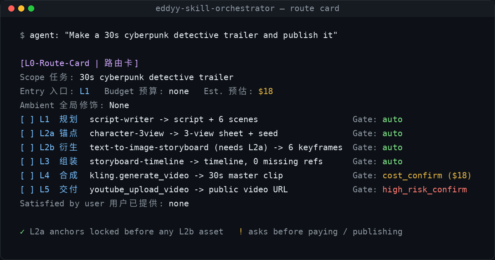

# Eddyy Skill Orchestrator (`eddyy-skill-orchestrator`)

> **Chaining AI tools goes wrong in boring ways:** steps run in the wrong order, faces drift because the character sheet wasn't locked first, and a paid render or a publish fires before anyone said yes.
> This Agent Skill makes the agent print a route card first, lock anchors before deriving from them, and stop only where money or irreversible actions are involved.
>
> 让 Agent 串联多个 Skill / MCP 时有顺序、有锚点、花钱和发布前先确认。

[](LICENSE)
[](#running-the-tests-and-scripts)
[](https://m8ven.ai/mcp/yanmeng0113-ctrl-eddyy-skill-orchestrator-1jmz13?s=readme)

**A planning layer for agents that have many Skills and MCP tools: order the work, lock what must stay consistent, and pause only where money or irreversible effects are involved. | 面向多 Skill / MCP 场景的总控调度层：排好执行顺序、锁定需要保持一致的锚点，只在涉及花钱或不可逆操作时才暂停确认。**

**One-liner:** `npx skills add yanmeng0113-ctrl/eddyy-skill-orchestrator` · or `git clone … && bash install.sh` · hosts: Claude Code / Cursor / Codex / WorkBuddy / `~/.agents`

Follows the open Agent Skills layout (`SKILL.md` plus `references/`, `assets/`, `scripts/`).

<p align="center"></p>

<sub>Route card for <a href="assets/example-pipeline.json"><code>assets/example-pipeline.json</code></a>, rendered from the template in <code>SKILL.md</code>.</sub>

## Quick install (快速安装)

```bash
git clone https://github.com/yanmeng0113-ctrl/eddyy-skill-orchestrator.git
cd eddyy-skill-orchestrator && bash install.sh            # auto-detects ~/.claude, ~/.agents, ~/.cursor, ~/.codex, ~/.workbuddy skill dirs
bash install.sh --target /path/to/your/skills --no-scan  # or install into an explicit dir (repeatable)
```

Or copy manually: `cp -r eddyy-skill-orchestrator ~/.claude/skills/` (or your agent's skills dir). `SKILL.md` alone is enough; `scripts/` adds the validator, checkpoint tool and scanner. Upgrading with `install.sh` never deletes: the previous install is kept as `eddyy-skill-orchestrator.old-<timestamp>`. Details in [Install](#install-安装).


## 60-second demo (一分钟上手)

Install, classify a risky request, and validate the example plan:

```bash
git clone https://github.com/yanmeng0113-ctrl/eddyy-skill-orchestrator.git
cd eddyy-skill-orchestrator && bash install.sh
python3 scripts/scan_inventory.py --classify "render a paid Kling video then publish to YouTube"
python3 scripts/validate_pipeline.py assets/example-pipeline.json
```

Expected output (abridged):

```text
$ bash install.sh --target ~/.claude/skills --no-scan
Installing eddyy-skill-orchestrator ...
  [ok] ~/.claude/skills/eddyy-skill-orchestrator
Done. Installed into 1 location(s).

$ python3 scripts/scan_inventory.py --classify "render a paid Kling video then publish to YouTube"
{
  "candidate_tiers": ["L4", "L5"],
  "default_gate": "high_risk_confirm",
  "cost_sensitive": true,
  "external_mutation_risk": true
}

$ python3 scripts/validate_pipeline.py assets/example-pipeline.json
[L0-Validator] PASSED: '30s cyberpunk detective trailer' (Entry: L1)
```

What you get next: the agent prints a **route card** before tools run (see the image above), locks L2a anchors before L2b assets, and only pauses on `cost_confirm` / `high_risk_confirm`.

Prefer a zip? Grab the latest release asset and copy the folder into your skills dir — no git required.

## What's new in 0.5.1

Skill inventory scan now follows directory symlinks (and safely skips symlink loops), so symlink-based custom-skills installs are discovered instead of returning an empty list.

## What's new in 0.5.0

- **Configured vs. Verified Tool Status**: Tool entries clearly distinguish between mere presence (`configured`), tested readiness (`verified` via live probe/call or `--verified`), and missing commands (`unavailable`). Paid and high-risk operations prioritize verified tools.
- **Node-Level Checkpoint Resume**: Granular node state (`state["nodes"]`) with DAG dependencies, artifact tracking, and targeted invalidation via `rerun --id X` that clears only downstream artifacts while keeping upstream and parallel nodes intact.
- **Fallback Tool Switching**: Dynamic resilience with `next-tool --id X --unavailable T,...`, selecting the next eligible tool from registered fallbacks after retries.
- **Real Artifact Acceptance**: Delivery acceptance strictly checks that real artifacts satisfy L1 requirements — a successful tool invocation is not task completion.

## Why (为什么需要)

With dozens of flat Skills and MCP tools an agent tends to skip steps (storyboard frames before the character sheet is locked, so faces drift between shots), waste paid compute, or nag the user at every trivial step. This skill adds a thin, explicit plan on top:

- **Relative tiers, not fixed ones.** `L0-Ambient` plus `L1` to `L5`, recomputed for each request. A whole video pipeline is `L1-L4` on its own and a single `L3` node inside a launch campaign.
- **Anchor before derive.** `L2a` (character sheet, design tokens, schema, voice clone) is locked before any `L2b` asset is generated.
- **Gates by action, not by tier.** `auto`, `cost_confirm`, `high_risk_confirm`, decided from what an action does. A user-approved budget lets paid steps inside it run without per-step prompts.
- **Checkpoints and bounded retries.** Locked seeds and completed tiers survive pauses and context compaction; a faulty node is re-run at most twice, then escalated.
- **Light mode.** Two-step linear tasks get a one-line plan, not a route card.

```text
Request ─► route card ─► L1 plan ─► L2a anchors ─► L2b derived ─► L3 assemble ─► L4 synthesize ─► L5 deliver
                           │            │ lock          │ handshake     │ handshake    cost_confirm      high_risk_confirm
                           └────────────┴───────────────┴──────────────┴─ rollback only the faulty node (max 2 retries)
           L0-Ambient (tone, brevity, design/code style) applies across every tier
```

| Gate | When | Behaviour |
| :-- | :-- | :-- |
| `auto` | Reversible and internal: reads, drafts, local renders, feature-branch writes | Proceed |
| `cost_confirm` | Spends money or paid quota | Ask with the exact estimate, unless the cumulative estimate fits the budget the user pre-approved |
| `high_risk_confirm` | Irreversible or externally visible: publish, send, deploy, merge to default branch, delete, pay | Always ask |

## Safety model (安全边界)

- The gates are applied by the agent after it has looked at what a tool really does. The host's own permission prompts always take precedence, and this skill never suppresses them.
- `scripts/scan_inventory.py` is an **advisory** keyword classifier over names and descriptions. It matches destructive and external actions in English and Chinese, honours explicit "read-only" wording for the weaker terms, and reports unrecognised tools as `probe_required` instead of `auto`. It cannot see a tool's real behaviour: do not treat its output as a guarantee.
- `scripts/validate_pipeline.py` checks a written plan: dependencies exist and point upstream, `L2b` depends on `L2a`, `L5` is always `high_risk_confirm`, tools whose names signal an external or destructive action are never `auto`, paid work under `auto` fits a pre-approved budget, and nested gates bubble up.
- MCP config scanning classifies only server name, command, args and URL host. `env` and `headers` (where secrets live) are never read into classification or written to the output.

## Install (安装)

**Clone and run the installer** (detects Claude Code, `~/.agents`, Cursor, Codex and WorkBuddy directories; pass `--target` for anything else):

```bash
git clone https://github.com/yanmeng0113-ctrl/eddyy-skill-orchestrator.git
cd eddyy-skill-orchestrator && bash install.sh
bash install.sh --target /path/to/your/skills      # explicit location, repeatable
```

**Via the [skills CLI](https://github.com/vercel-labs/skills)** (if you use it):

```bash
npx skills add yanmeng0113-ctrl/eddyy-skill-orchestrator
```

**Manual copy.** `SKILL.md` alone is enough for planning, route cards and gates. Copy `references/`, `assets/` and `scripts/` next to it to get the domain matrix, the plan schema, the validator, the checkpoint tool and the scanner.

**Upgrades never delete.** `install.sh` stages the new version, renames the previous install to `eddyy-skill-orchestrator.old-<timestamp>` and moves the staged copy into place. Nothing is removed, so the installer cannot block on a host that puts `rm` behind an approval prompt, and you can roll back by moving the kept directory back. Delete the kept directory yourself when you no longer need it.

### Compatibility (兼容性)

Works with any host that loads Agent Skills: Claude Code, Cursor, WorkBuddy, `~/.agents`, and **OpenAI Codex**. For Codex the scanner reads skills from the locations [Codex documents](https://developers.openai.com/codex/skills) — `.agents/skills` in every directory from cwd up to the git root, `~/.agents/skills` and `/etc/codex/skills` — plus `$CODEX_HOME/skills` (default `~/.codex/skills`, where Codex keeps its bundled `.system` skills and its skill-installer writes), and MCP servers from the `[mcp_servers.<name>]` tables in `~/.codex/config.toml` (or `$CODEX_HOME/config.toml`) and the project-level `.codex/config.toml`. TOML parsing uses stdlib `tomllib` (Python 3.11+); on 3.9/3.10 the Codex TOML files are skipped silently and everything else still works. As for JSON configs, only `command`, `args` and the URL host are classified; `env`, `env_vars`, `http_headers`, `env_http_headers`, `bearer_token_env_var` and `oauth` are never read into classification or output.

### If the scanner misses your skills (扫描不到宿主技能时)

`scripts/scan_inventory.py` reads a fixed set of roots: `./skills`, `~/.claude/skills`, `~/.agents/skills`, `~/.workbuddy/skills`, `~/.codex/skills` (or `$CODEX_HOME/skills`), `/etc/codex/skills`, parent `.agents/skills` up to the git root, `~/.workbuddy/plugins/cache`, `~/.cursor/extensions` plus anything in **`L0_SKILL_ROOTS`**. Hosts that keep their skills somewhere else (or expose them only inside the session) are invisible to a file scan — point the scanner at the right directory, or at a directory of *manifest stubs* (small SKILL.md pointer files carrying the real `name` and `description`, so the classifier still works):

```bash
L0_SKILL_ROOTS="/path/to/skills" python3 scripts/scan_inventory.py inventory.json
```

The scanner prints a stderr summary at the end: which roots existed but matched nothing, duplicate names (which copy was kept), and the list of unrecognised `probe_required` tools. `install.sh` prints the same hint after its own scan. Windows uses `;` as the separator (same as `os.pathsep`).

### Windows notes (Windows 用户注意)

- Run the installer with **Git Bash** (`bash install.sh`), not WSL: the script needs GNU `cp`/`mv`, and the tests locate Git Bash explicitly.
- `L0_SKILL_DIRS` and `L0_SKILL_ROOTS` are separated by `;` on Windows (`:` elsewhere), so drive letters survive.
- The scripts need `python` >= 3.9 on `PATH` (`python3` is not standard on Windows); the installer falls back to `python` automatically.
- The installer performs **no deletions**, so it cannot hang on a host that puts `rm` behind an approval prompt.

## Repository layout (目录结构)

```text
eddyy-skill-orchestrator/
├── SKILL.md                      # instructions the agent loads (kept short)
├── references/tier-mapping-guide.md   # domain matrix, composite MCP splitting, nesting, handshake, gate edge cases
├── assets/pipeline-schema.json   # plan schema (nested sub_pipeline, budget, retries)
├── assets/example-pipeline.json  # a valid plan to copy
├── scripts/
│   ├── scan_inventory.py         # advisory scanner; also --classify "<text>"
│   ├── validate_pipeline.py      # plan validator, exit 0/1/2
│   └── checkpoint_state.py       # init / lock / complete-tier / confirm / rollback / show
├── evals/evals.json              # 14 behavioural evals incl. near-miss negatives
├── tests/                        # unit tests and fixtures
├── install.sh   CONTRIBUTING.md   CHANGELOG.md   LICENSE
├── docs/route-card.png          # demo image
└── .github/ISSUE_TEMPLATE/       # issue template
```

## Running the tests and scripts (测试与脚本)

Standard library only, Python 3.9 or newer.

```bash
python3 -m unittest discover -s tests -p "test_*.py" -v

python3 scripts/scan_inventory.py .l0-inventory.json              # index local skills and MCP servers
python3 scripts/scan_inventory.py --classify "git push --force"   # classify one description
python3 scripts/validate_pipeline.py assets/example-pipeline.json # validate a plan

python3 scripts/checkpoint_state.py init --scope "30s Trailer" --entry L1
python3 scripts/checkpoint_state.py lock --key protagonist_seed --value seed_849201_ref.png
python3 scripts/checkpoint_state.py complete-tier --tier L3 --output timeline.json --next-tier L4 --status awaiting_confirmation
python3 scripts/checkpoint_state.py confirm --tier L4 --note "USD 18 approved"
python3 scripts/checkpoint_state.py rollback --to L2b --reason "face drift in scene 3"
python3 scripts/checkpoint_state.py show --brief
```

A corrupt state file is never silently reset: the command fails with exit code 4 and keeps a copy. Use `--file` or `$L0_STATE_FILE` to keep one state file per project.

## License

MIT.
